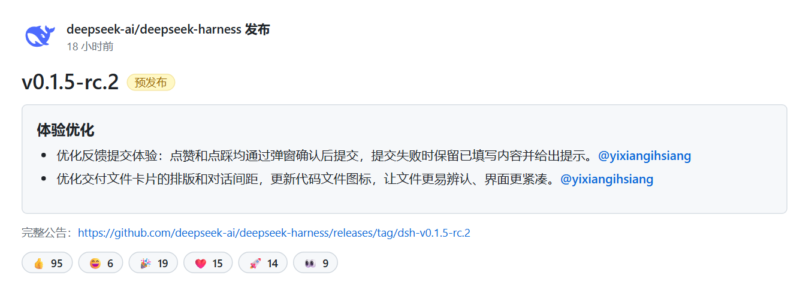

# nonebot-plugin-github-release

监控任意 GitHub 仓库的 release，把新版本推送到 QQ 群。按群订阅，每个群只收自己关心的仓库。

本插件由 [nonebot-plugin-dsh-release](https://github.com/NSQX13579/nonebot-plugin-dsh-release) 改进而得。

## 安装

```bash
pip install nonebot-plugin-github-release
playwright install chromium        # 卡片图片需要，不装会自动回退纯文本
```

依赖 `nonebot-plugin-apscheduler`（定时）和 `nonebot-plugin-localstore`（数据目录），装包时会一并带上。

## 配置

`.env`（完整模板见 `.env.example`）：

```dotenv
# 监控哪些仓库（留空也行，直接在群里 /gh订阅）
GH_WATCH_REPOS=[]
GH_WATCH_GROUPS=[]

# 可选：匿名 API 限额 60 次/小时且按出口 IP 共享，多仓库建议配上
GH_WATCH_GITHUB_TOKEN=
```

插件不带任何默认仓库——用群里的 `/gh订阅 owner/repo` 加，或者把上面的列表填上。

## 指令

| 指令 | 权限 | 说明 |
| --- | --- | --- |
| `/gh订阅 owner/repo` | 群管 | 本群订阅某个仓库 |
| `/gh退订 owner/repo` | 群管 | 取消订阅 |
| `/gh列表` | 所有人 | 看本群订阅了哪些仓库 |
| `/gh公告 owner/repo` | 所有人 | 最新一条 release 全文 |
| `/gh公告 owner/repo 5` | 所有人 | 列最近 5 条（最多 10） |
| `/gh公告 owner/repo v1.2` | 所有人 | 按版本号检索 |
| `/gh状态` | 所有人 | 推送状态 |
| `/gh检查` | 超管 | 立刻检查一次，不等下一轮 |

## 消息长什么样



图下面另附一行带链接的文字。

**渲染出任何问题都会回退纯文本**（没装 htmlrender、没装 chromium、超时都算），只打一条警告日志，推送不受影响。

## 行为说明

- 数据源：Releases API 为主，被限流时自动切到不限流的 `releases.atom`
- 首次运行只建推送基线，不会把历史 release 刷进群
- 以 tag 去重，失败的不写进已推送列表，下一轮自然重试
- 中英双语正文默认只保留中文段，`GH_WATCH_BODY_LANGUAGE=all` 可改成两段都留
- `GH_WATCH_INCLUDE_PRERELEASE=False` 则只推正式版

## License

MIT
